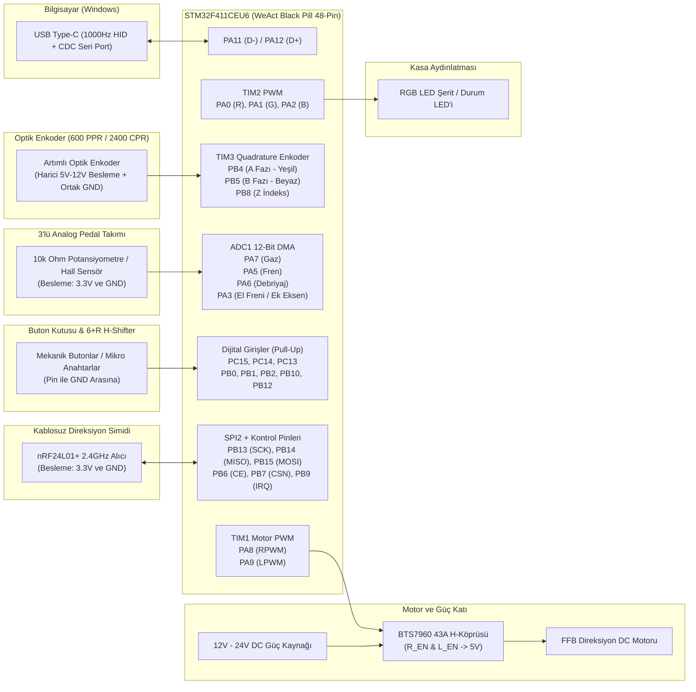

# Velocity Control Hub & OpenFFBoard STM32F411CE Firmware

**Sürüm:** v3.17.0  
**Hedef Donanım:** STM32F411CEU6 (WeAct Black Pill V3.1 - 48 Pin)  
**Motor Sürücü:** BTS7960 (IBT-2) Çift Yönlü H-Köprüsü  
**Altyapı:** OpenFFBoard Tabanlı Gerçek Zamanlı Force Feedback (1000 Hz USB HID + CDC VCP)

Velocity Control Hub, STM32F411CEU6 mikrodenetleyicisi üzerine inşa edilmiş Direct Drive / kayışlı Force Feedback (FFB) direksiyon sistemleri, analog pedal setleri, 6+R H-Shifter vites modülleri ve nRF24L01 tabanlı kablosuz direksiyon simidi aksesuarları için geliştirilmiş bütünleşik bir donanım yazılımı (firmware) ve masaüstü sürücü/yapılandırma uygulamasıdır.

---

## İçindekiler

1. [Temel Özellikler](#1-temel-özellikler)
2. [Genel Sistem Bağlantı Şeması](#2-genel-sistem-bağlantı-şeması)
3. [STM32F411CEU6 (Black Pill) Tam Pin Haritası](#3-stm32f411ceu6-black-pill-tam-pin-haritası)
4. [Modül Bazlı Detaylı Bağlantı Tabloları](#4-modül-bazlı-detaylı-bağlantı-tabloları)
   - [4.1 BTS7960 Motor Sürücü Bağlantısı (TIM1 PWM)](#41-bts7960-motor-sürücü-bağlantısı-tim1-pwm)
   - [4.2 Optik Enkoder Bağlantısı (TIM3 Quadrature)](#42-optik-enkoder-bağlantısı-tim3-quadrature)
   - [4.3 Analog Pedal Seti ve El Freni Bağlantısı (ADC1 DMA)](#43-analog-pedal-seti-ve-el-freni-bağlantısı-adc1-dma)
   - [4.4 Kablolu Butonlar ve 6+R H-Shifter Vites Bağlantısı (DIN0 - DIN7)](#44-kablolu-butonlar-ve-6r-h-shifter-vites-bağlantısı-din0---din7)
   - [4.5 nRF24L01+ 2.4GHz Kablosuz Aksesuar Alıcısı Bağlantısı (SPI2)](#45-nrf24l01-24ghz-kablosuz-aksesuar-alıcısı-bağlantısı-spi2)
   - [4.6 Kasa RGB LED Bağlantısı (TIM2 PWM)](#46-kasa-rgb-led-bağlantısı-tim2-pwm)
5. [Elektriksel Kurallar ve Pin Çakışma Koruması](#5-elektriksel-kurallar-ve-pin-çakışma-koruması)
6. [Kurulum ve Tek Tuşla Otomatik DFU Güncelleme](#6-kurulum-ve-tek-tuşla-otomatik-dfu-güncelleme)
7. [Seri Haberleşme Protokolü (USB CDC Komutları)](#7-seri-haberleşme-protokolü-usb-cdc-komutları)
8. [Kaynak Koddan Derleme](#8-kaynak-koddan-derleme)

---

## 1. Temel Özellikler

- **1000 Hz Gerçek Zamanlı Force Feedback:** USB HID PID (Physical Interface Device) protokolü üzerinden yay, sönümleme (damper), sürtünme (friction), atalet (inertia) ve sabit kuvvet (constant force) efektlerini 1 ms döngü süresiyle işler.
- **Donanım Kimliği Profilleri (Hardware Spoofing):** Cihaz kimliğini oyun uyumluluğuna göre çalışma zamanında değiştirebilir (`OpenFFBoard Native`, `Logitech G29`, `Moza R5`).
- **Tek Tuşla Otomatik DFU Firmware Güncelleme:** BOOT0 tuşuna veya jumper müdahalesine gerek kalmadan, sürücü üzerinden yazılımsal komutla (`sys.dfu=1`) STM32 ROM DFU Bootloader (`0483:DF11`) moduna geçiş yapar, `.hex` dosyasını doğrular, yükler ve yeni sürümü otomatik teyit eder.
- **Donanımsal Mavi SMD LED Sürüm Doğrulaması (`PC13`):** Sürücü arayüzüne bakmaksızın kartın üzerindeki fiziksel yazılımı doğrulamak için, STM32 üzerindeki dahili mavi SMD LED (`PC13`) enerji verildiğinde ilk **10 saniye boyunca sabit yanar** ve **10. saniyede tamamen söner**.
- **İzole nRF24L01+ 2.4GHz Kablosuz Alıcı Desteği:** Direksiyon simidi üzerindeki kablosuz butonları ve ek eksenleri `SPI2` hattı üzerinden FFB döngüsünü bloklamadan okur. Modül takılı olmadığında sıfır işlemci yüküyle standart kablolu modda çalışır.
- **Tek Kaynaklı Sürüm Yönetimi:** Firmware (`SW_VERSION_INT`), `.hex` paket adı ve masaüstü sürücüsü (`version.json`) tek bir sürüm kaynağından senkronize edilir.
- **Sade Kullanıcı Arayüzü ve Geliştirici Modu:** Günlük kullanımda yalnızca temel FFB, direksiyon ve tek tuşla güncelleme kontrolleri gösterilir; düşük seviyeli donanım ve RF parametreleri kalıcı Geliştirici Modu altında korunur.

---

## 2. Genel Sistem Bağlantı Şeması

Aşağıdaki şema, kaynak koddaki (`Targets/F411CE_V3_Profiles/Core/Inc/main.h` ve `stm32f4xx_hal_msp.c`) tüm çevre birimlerinin STM32F411CEU6 mikrodenetleyicisine olan fiziksel bağlantılarını göstermektedir:



---

## 3. STM32F411CEU6 (Black Pill) Tam Pin Haritası

Aşağıdaki ASCII diyagramı, WeAct Black Pill V3.1 kartının fiziksel pin dizilimini ve yazılım içindeki birebir görevlerini göstermektedir:

```text
                      +-----------------------------------+
                      |        USB Type-C Konnektör       |
                      +-----------------------------------+
   [LED_SYS / DIN2]   | PC13                         3V3  | [3.3V Çıkış - Pedal & nRF24]
   [DIN1 (Buton/V2)]  | PC14                         GND  | [Ortak Toprak (GND)]
   [DIN0 (Buton/V1)]  | PC15                         5V   | [5V Giriş/Çıkış]
   [Reset]            | NRST                         PB9  | [nRF24_IRQ (Pull-Up Giriş)]
   [RGB_R / AIN0]     | PA0                          PB8  | [ENCODER_Z (İndeks Girişi)]
   [RGB_G / AIN1]     | PA1                          PB7  | [nRF24_CSN (SPI2 Chip Select)]
   [RGB_B / AIN2]     | PA2                          PB6  | [nRF24_CE  (Chip Enable)]
   [Ek Eksen / AIN3]  | PA3                          PB5  | [ENCODER_B (TIM3_CH2 - Beyaz)]
   [Yedek / AIN4]     | PA4                          PB4  | [ENCODER_A (TIM3_CH1 - Yeşil)]
   [FREN Pedalı]      | PA5 (ADC1_IN5)               PB3  | [Serbest GPIO]
   [DEBRİYAJ Pedalı]  | PA6 (ADC1_IN6)               PA15 | [SPI2_NSS (Dahili/Yedek)]
   [GAZ Pedalı]       | PA7 (ADC1_IN7)               PA12 | [USB OTG_FS D+ (DP)]
   [DIN3 (Buton/V4)]  | PB0                          PA11 | [USB OTG_FS D- (DM)]
   [DIN4 (Buton/V5)]  | PB1                          PA10 | [Serbest GPIO / UART_RX]
   [DIN5 (Buton/V6)]  | PB2                          PA9  | [MOTOR PWM2 (TIM1_CH2 - LPWM)]
   [DIN6 (Buton/VR)]  | PB10                         PA8  | [MOTOR PWM1 (TIM1_CH1 - RPWM)]
   [3.3V]             | 3V3                          PB15 | [nRF24_MOSI (SPI2_MOSI)]
   [Ortak Toprak]     | GND                          PB14 | [nRF24_MISO (SPI2_MISO)]
   [5V]               | 5V                           PB13 | [nRF24_SCK  (SPI2_SCK)]
                      |                              PB12 | [DIN7 (Buton 8)]
                      +-----------------------------------+
                              | SWDIO (PA13) | SWCLK (PA14) |
                              +-----------------------------+
```

---

## 4. Modül Bazlı Detaylı Bağlantı Tabloları

### 4.1 BTS7960 Motor Sürücü Bağlantısı (`TIM1` PWM)

Kod içerisinde motor sürücüsü `PWMDRIVER` (`MotorPWM.cpp`) sınıfı ile `TIM1` donanım zamanlayıcısı üzerinden sürülür (`0-100% Dual PWM` modu).

| BTS7960 Pini | STM32 / Güç Bağlantısı | Kod Tanımı (`main.h`) | Açıklama |
| :--- | :--- | :--- | :--- |
| **RPWM** | **`PA8`** | `PWM1_Pin` (`TIM1_CH1`) | Sağ yön PWM sinyali |
| **LPWM** | **`PA9`** | `PWM2_Pin` (`TIM1_CH2`) | Sol yön PWM sinyali |
| **R_EN** | **`5V` (veya `3.3V`)** | Donanımsal Köprü | Sağ yarı-köprü yetkilendirme (Aktif Yüksek) |
| **L_EN** | **`5V` (veya `3.3V`)** | Donanımsal Köprü | Sol yarı-köprü yetkilendirme (Aktif Yüksek) |
| **VCC** | **`5V` (veya `3.3V`)** | Lojik Besleme | BTS7960 entegre lojik beslemesi |
| **GND** | **`GND`** | Ortak Toprak | STM32 `GND` pini ile birleştirilmelidir |
| **B+ / B-** | **12V - 24V PSU** | Güç Girişi | Harici motor güç kaynağı uçları |
| **M+ / M-** | **DC Motor Uçları** | Motor Çıkışı | FFB direksiyon motoru uçları |

---

### 4.2 Optik Enkoder Bağlantısı (`TIM3` Quadrature)

Kod içerisinde enkoder `EncoderLocal.cpp` sınıfı ile `TIM3` donanımsal enkoder arayüzü (`TIM_ENCODERMODE_TI12`) üzerinden okunur. Varsayılan çözünürlük **600 PPR = 2400 CPR** olarak ayarlanmıştır.

| Enkoder Kablosu / Pini | STM32 / Güç Bağlantısı | Kod Tanımı (`main.h`) | Açıklama |
| :--- | :--- | :--- | :--- |
| **A Fazı (Yeşil)** | **`PB4`** | `ENCODER_A_Pin` (`TIM3_CH1`) | 5V toleranslı, dahili Pull-Up aktif |
| **B Fazı (Beyaz)** | **`PB5`** | `ENCODER_B_Pin` (`TIM3_CH2`) | 5V toleranslı, dahili Pull-Up aktif |
| **Z Fazı (Sarı/İndeks)** | **`PB8`** *(Opsiyonel)* | `ENCODER_Z_Pin` (`EXTI8`) | Merkez indeks sinyali (kullanılmıyorsa boş bırakılır) |
| **VCC (Kırmızı)** | **Harici 5V - 12V** | Enkoder Beslemesi | Enkoder çalışma gerilimine uygun besleme (Örn. 12V) |
| **GND (Siyah)** | **`GND` (Ortak Toprak)** | Ortak Referans | Harici beslemenin eksisi (`-`) ile STM32 `GND` birleştirilmelidir |
| **Ekran / Zırh (Shield)** | **`GND`** | Gürültü Koruması | Kablo metal zırhı yalnızca STM32 tarafında `GND`ye bağlanır |

> **Önemli Enkoder Notu:** `PB4` ve `PB5` pinlerinde yazılım içinde dahili `GPIO_PULLUP` aktiftir. Harici 12V ile beslenen NPN açık kollektör (Open-Collector) enkoderlerde enkoder çıkışı hattı yalnızca `GND`ye çeker; bu nedenle harici direnç olmadan da çalışır. Yüksek elektromanyetik gürültülü ortamlarda sinyali daha da sertleştirmek isterseniz `PB4` ile `3.3V` arasına ve `PB5` ile `3.3V` arasına `1kΩ - 4.7kΩ` pull-up direnci bağlayabilirsiniz.

---

### 4.3 Analog Pedal Seti ve El Freni Bağlantısı (`ADC1` DMA)

Analog girişler `ADC1` çevre birimi ve `DMA2_Stream0` üzerinden 12-bit çözünürlükle kesintisiz okunur (`MX_ADC1_Init`).

| Fonksiyon / Pedal | STM32 Pini | ADC Kanalı ve Sırası | Besleme Bağlantısı |
| :--- | :--- | :--- | :--- |
| **Gaz Pedalı** | **`PA7`** | `ADC1_IN7` (Rank 3) | Potansiyometre kenar uçları: **`3.3V`** ve **`GND`** |
| **Fren Pedalı** | **`PA5`** | `ADC1_IN5` (Rank 4 / `AIN5`) | Potansiyometre kenar uçları: **`3.3V`** ve **`GND`** |
| **Debriyaj Pedalı** | **`PA6`** | `ADC1_IN6` (Rank 5) | Potansiyometre kenar uçları: **`3.3V`** ve **`GND`** |
| **El Freni / Ek Eksen** | **`PA3`** | `ADC1_IN3` (Rank 8 / `AIN3`) | Potansiyometre kenar uçları: **`3.3V`** ve **`GND`** |
| **Yedek Analog (`AIN4`)** | **`PA4`** | `ADC1_IN4` (Rank 6) | Yedek / Devre dışı |

> **Uyarı:** STM32 analog (`ADC`) pinleri **5V toleranslı değildir**. Potansiyometrelerin veya Hall sensörlerinin besleme uçlarını kesinlikle `5V` yerine **`3.3V`** ve **`GND`** pinlerine bağlayın.

---

### 4.4 Kablolu Butonlar ve 6+R H-Shifter Vites Bağlantısı (`DIN0` - `DIN7`)

Dijital buton girişleri `LocalButtons.cpp` tarafından dahili Pull-Up ile okunur. Anahtarlar ilgili pin ile `GND` arasına bağlanır.

| Dijital Giriş | STM32 Pini | Kod Tanımı (`main.h`) | Varsayılan Kullanım |
| :--- | :--- | :--- | :--- |
| **DIN0** | **`PC15`** | `DIN0_Pin` (`BUTTON_A`) | Buton 1 / H-Shifter 1. Vites |
| **DIN1** | **`PC14`** | `DIN1_Pin` | Buton 2 / H-Shifter 2. Vites |
| **DIN2** | **`PC13`** | `DIN2_Pin` | Buton 3 / H-Shifter 3. Vites |
| **DIN3** | **`PB0`** | `DIN3_Pin` | Buton 4 / H-Shifter 4. Vites |
| **DIN4** | **`PB1`** | `DIN4_Pin` | Buton 5 / H-Shifter 5. Vites |
| **DIN5** | **`PB2`** | `DIN5_Pin` | Buton 6 / H-Shifter 6. Vites |
| **DIN6** | **`PB10`** | `DIN6_Pin` | Buton 7 / H-Shifter Geri Vites (R) |
| **DIN7** | **`PB12`** | `DIN7_Pin` | Buton 8 / Ek Aksesuar Butonu |

---

### 4.5 nRF24L01+ 2.4GHz Kablosuz Aksesuar Alıcısı Bağlantısı (`SPI2`)

Kablosuz direksiyon simidi tuşları, kulakçık vitesler (paddle shifters) ve kablosuz aksesuarlar için `Nrf24Module.cpp` sürücüsü donanımsal **`SPI2`** birimini kullanır.

| nRF24L01+ Pini | STM32 Pini | Kod Tanımı (`main.h`) | Açıklama |
| :--- | :--- | :--- | :--- |
| **VCC** | **`3.3V`** | Güç Beslemesi | **Yalnızca 3.3V** (5V uygulanmamalıdır; 10µF kondansatör önerilir) |
| **GND** | **`GND`** | Toprak | STM32 `GND` hattı |
| **CE** | **`PB6`** | `NRF24_CE_Pin` | Chip Enable (GPIO Çıkış) |
| **CSN** | **`PB7`** | `NRF24_CSN_Pin` | SPI Chip Select (Active-Low GPIO Çıkış) |
| **SCK** | **`PB13`** | `NRF24_SCK_Pin` (`SPI2_SCK`) | Donanımsal SPI2 Saat Sinyali (3 MHz) |
| **MOSI** | **`PB15`** | `NRF24_MOSI_Pin` (`SPI2_MOSI`) | Donanımsal SPI2 Veri Çıkışı |
| **MISO** | **`PB14`** | `NRF24_MISO_Pin` (`SPI2_MISO`) | Donanımsal SPI2 Veri Girişi (Dahili Pull-Down) |
| **IRQ** | **`PB9`** *(Opsiyonel)* | `NRF24_IRQ_Pin` | Paket hazır kesme pini (Dahili Pull-Up Giriş) |

#### Kablosuz Paket Formatı (`8 Byte Payload`, Varsayılan Kanal: `76` / `2476 MHz`, Pipe 0: `0xE7E7E7E7E7`)
- **`Byte 0..3` (`uint32_t` Little-Endian):** 32-bit kablosuz buton maskesi. Kablolu butonların hemen ardından USB HID raporuna otomatik eklenir. 500 ms boyunca paket gelmezse güvenlik (fail-safe) amacıyla butonlar otomatik bırakılır.
- **`Byte 4..5` (`int16_t` Little-Endian):** Kablosuz yardımcı eksen 0 (Örn. kablosuz debriyaj kulakçığı).
- **`Byte 6..7` (`int16_t` Little-Endian):** Kablosuz yardımcı eksen 1.

---

### 4.6 Kasa RGB LED Bağlantısı (`TIM2` PWM)

`FFBWheel.cpp` içerisindeki `RgbThread` görevinde `TIM2` zamanlayıcısı üzerinden nefes alma (breathing) animasyonu üretilir:

| Kanal | STM32 Pini | Zamanlayıcı Kanalı |
| :--- | :--- | :--- |
| **Kırmızı (Red)** | **`PA0`** | `TIM2_CH1` |
| **Yeşil (Green)** | **`PA1`** | `TIM2_CH2` |
| **Mavi (Blue)** | **`PA2`** | `TIM2_CH3` |

---

## 5. Elektriksel Kurallar ve Pin Çakışma Koruması

1. **Neden `PA8 / PB0 / PA5 / PA6 / PA7` Pinleri nRF24L01 İçin Kullanılmaz?**
   - Standart Arduino/STM32 örneklerinde sıkça görülen `SPI1` (`PA5/PA6/PA7`) ve `PA8`/`PB0` pinleri bu projede **Motor PWM (`PA8`)**, **Analog Pedallar (`PA5, PA6, PA7`)** ve **Kablolu Buton (`PB0`)** tarafından aktif olarak kullanılmaktadır. Bu nedenle nRF24L01 modülü tamamen bağımsız olan **`SPI2` (`PB13, PB14, PB15`) + `PB6, PB7, PB9`** pinlerine atanmıştır.
2. **Ortak Toprak (`GND`) Zorunluluğu:**
   - Harici 12V/24V motor güç kaynağının, harici enkoder beslemesinin ve STM32 kartının `GND` (eksi) hatları birbirine bağlanmalıdır. Ortak toprak olmazsa enkoder darbeleri ve PWM sinyalleri okunamaz.
3. **Gerilim Sınırları:**
   - Enkoderin `PB4` ve `PB5` pinleri **5V toleranslıdır**.
   - Analog pedal pinleri (`PA0-PA7`) ve nRF24L01 `VCC` beslemesi **yalnızca 3.3V** ile çalışır.

---

## 6. Kurulum ve Tek Tuşla Otomatik DFU Güncelleme

### Sürücü Kurulumu
1. GitHub [Releases](https://github.com/mertahmet41/Velocity-Control-Hub/releases) sayfasından en güncel **`Velocity_Control_Hub_Setup.exe`** kurulum sihirbazını (veya taşınabilir **`VelocityControlHub.exe`** dosyasını) indirin ve çalıştırın.
2. STM32F411CE kartınızı USB Type-C kablosu ile bilgisayara bağlayın. Uygulama cihazı otomatik algılayarak bağlanır.

### Tek Tuşla Cihaz Firmware Güncelleme
1. Uygulama içinden **Direksiyon -> Cihaz Güncelleme** sekmesini açın.
2. Uygulama cihazdaki mevcut sürümü (`sys.swver?`) okur ve paketteki `.hex` sürümüyle karşılaştırır.
3. **GÜNCELLE** butonuna tıkladığınızda:
   - Cihaz yazılımsal komutla (`sys.dfu=1`) otomatik olarak STM32 ROM DFU moduna (`0483:DF11`) geçirilir (BOOT0 tuşuna veya jumper'a basmanıza gerek yoktur).
   - Firmware (`.hex`) doğrulanarak STM32 Flash belleğine yazılır.
   - Cihaz otomatik olarak normal çalışma moduna döndürülür, seri bağlantı yeniden kurulur ve yeni sürüm numarası doğrulanır.

---

## 7. Seri Haberleşme Protokolü (USB CDC Komutları)

STM32 kartı USB üzerinden `115200 Baud` sanal seri port (CDC VCP) sağlar. Başlıca sistem ve teşhis komutları:

| Komut | Açıklama | Örnek Yanıt / Kullanım |
| :--- | :--- | :--- |
| `sys.swver?` | Yüklü firmware sürümünü döndürür | `3.17.0` |
| `sys.pedals?` | Gaz, Fren, Debriyaj ve Vites/Buton durumunu tek satırda döndürür (`gas:brake:clutch:btns`) | `-32768:-32768:-32768:0` |
| `sys.hwtype?` | Donanım hedef adını döndürür | `F411CE` |
| `sys.dfu=1` | Kartı yazılımsal olarak ROM DFU Bootloader moduna geçirir | Otomatik DFU geçişi |
| `sys.profile?` / `sys.profile=<0\|1\|2>` | USB cihaz kimliğini okur veya değiştirir (`0`=Native, `1`=G29, `2`=Moza) | `0` |
| `sys.save` | Değiştirilen parametreleri Flash (EEPROM emülasyonu) belleğe kaydeder | `OK` |
| `axis.pos?` | Canlı direksiyon enkoder pozisyonunu (pulse/tick) döndürür | `-120` |
| `axis.zeroenc` | Mevcut direksiyon açısını sıfır (merkez) noktası olarak kalibre eder | `OK` |
| `localenc.cpr?` / `localenc.cpr=2400` | Enkoder CPR (Count Per Revolution = PPR x 4) değerini okur veya ayarlar | `2400` |
| `localenc.pins?` | Enkoder A (`bit 0`), B (`bit 1`) ve Z (`bit 2`) pinlerinin anlık lojik durumunu okur | `3` |
| `sys.nrfstatus?` | nRF24L01 durumunu döndürür (`present:en:ch:rate:pa:rx_cnt:btn_mask:irq:status_reg`) | `1:1:76:1:2:140:0:1:14` |
| `sys.nrfen=<0\|1>` | nRF24L01 modülünü etkinleştirir veya devre dışı bırakır | `1` |
| `sys.nrfch=<0..125>` | nRF24L01 RF kanalını ayarlar (`2400 + ch` MHz) | `76` |
| `sys.nrfrate=<0\|1\|2>` | nRF24L01 veri hızını ayarlar (`0`=250kbps, `1`=1Mbps, `2`=2Mbps) | `1` |
| `sys.nrfpa=<0..3>` | nRF24L01 PA çıkış gücünü ayarlar (`0`=-18dBm .. `3`=0dBm) | `2` |

---

## 8. Kaynak Koddan Derleme

### Firmware Derlemesi (`OpenFFBoard_F411CE_V3_Profiles`)
Gereksinimler: `arm-none-eabi-gcc` ve `make`.

```powershell
cd Firmware
make clean MCU_TARGET=F411CE_V3_Profiles
make -j8 MCU_TARGET=F411CE_V3_Profiles
```

Derleme çıktısı `build/OpenFFBoard_F411CE_V3_Profiles.hex` olarak üretilir.

### Masaüstü Sürücü Uygulaması Derlemesi (`Velocity Control Hub`)
Gereksinimler: `Python 3.12+`, `pywebview`, `pyserial`, `pyinstaller`, `Inno Setup 6`.

```powershell
python -m PyInstaller --noconfirm --onefile --windowed --name "VelocityControlHub" `
  --add-data "index.html;." `
  --add-data "version.json;." `
  --add-data "pro_wheel.png;." `
  --add-data "wheel.png;." `
  --add-data "Firmware\OpenFFBoard_F411CE_V3_Profiles_v3.17.0.hex;Firmware" `
  --add-data "Firmware\OpenFFBoard_F411CE_V3_Profiles_v3.17.0.hex;." `
  app_launcher.py
```

---

## Lisans

Bu proje **GNU General Public License v3.0 (GPL-3.0)** kapsamında açık kaynaklı olarak sunulmaktadır.
